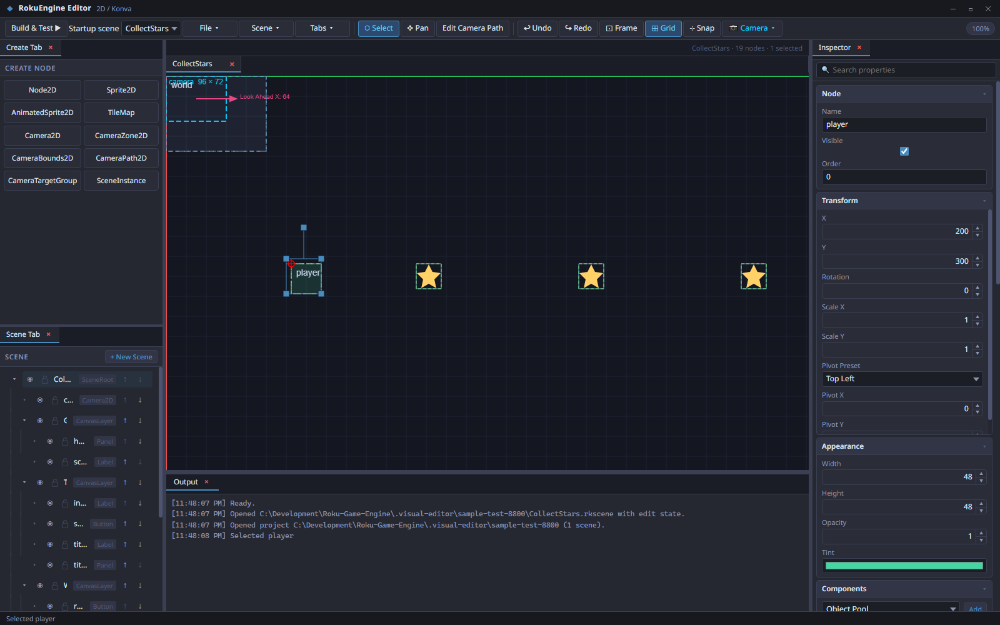
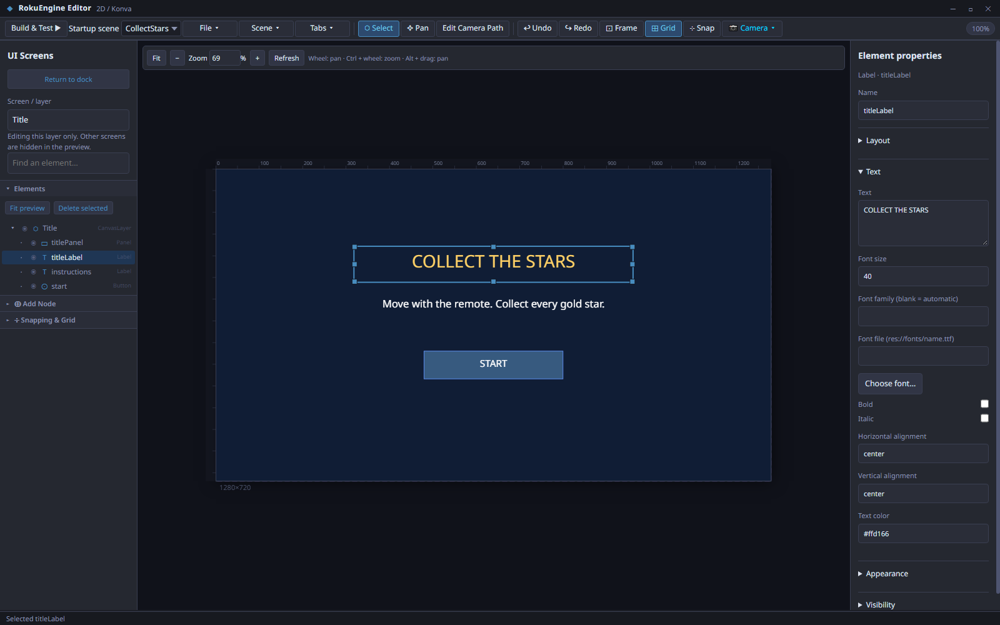
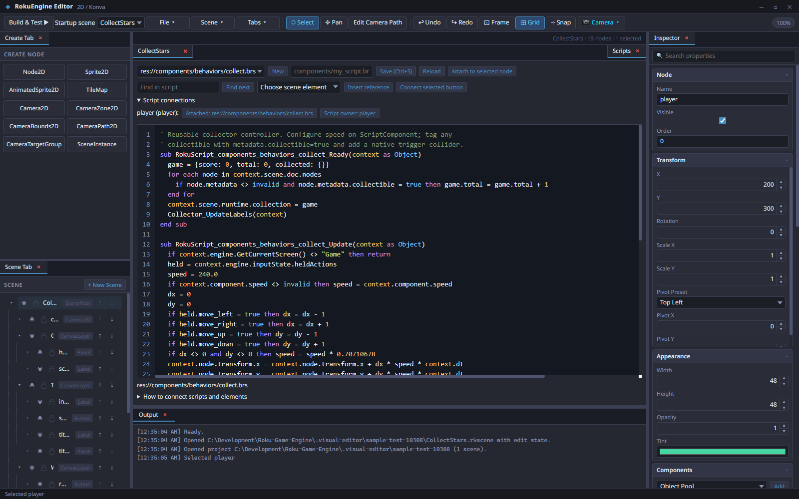

# Roku Game Engine

**Production Alpha · v0.1.0**

A desktop 2D game editor for Roku. Build scenes, design menus, connect BrightScript behaviors, and test a native Roku package from one workspace.



This alpha is available as a source checkout. It includes an editable sample game, integrated simulator testing, native BrightScript export, and Roku sideload tools. Runtime coverage is still growing; validate your game on Roku hardware before release.

Try the minimal [Scene to Scene example](samples/scene-to-scene/README.md) to verify a Title ? Play ? Title flow with native UI buttons. Open both scenes, choose a destination in the button's Action picker, and use F5 to test the configured startup scene. New CanvasLayers start at the screen origin; build validation checks scene/screen links, including menu items.

## What you can build

| Area | Available in this alpha |
| --- | --- |
| Scene editing | Node hierarchy, transforms, inspector, components, sprites, animated sprites, tilemaps, and scene instances |
| UI design | Dedicated screen/layer designer, anchors, stretch and alignment tools, zoom/pan, typography, custom fonts, and undo/redo |
| Artwork | Sprite sheet slicing, reusable atlas regions, and nine-slice UI backgrounds |
| Scripting | BrightScript editor with syntax highlighting, scene element references, script attachments, and UI action connections |
| Rendering | Native sprite rotation, flipping, tint, opacity, layer ordering, cropped textures, and UI clipping |
| Cameras | Follow, smoothing, lookahead, deadzones, bounds, zones, paths, target groups, dynamic zoom, and shake |
| Physics | AABB solid physics, selectable box/circle trigger contacts and swept projectile queries, mass, restitution, and parent-aware position correction |
| Audio | Streaming and one-shot playback; mixer, EQ, and effect settings baked into playback assets during export |
| Build workflow | F5 / Build & Test, runtime logs, Roku ZIP export, and device sideloading |
| Appearance | Dark, Light, and Mid-tone editor themes, saved across sessions and projects |

## Editor appearance

Open **Settings → Appearance → Editor color theme** and choose **Dark**, **Light**, or **Mid-tone** (the default medium slate palette). Changes apply immediately to open editor windows and save automatically for future sessions. Existing saved theme choices are preserved. The preference applies across projects; scene artwork and node colors keep their authored values.

Choose **Settings → Physics → Trigger contact method** to use **AABB** (box bounds, the default) or **Circle** (distance checks). `Collider2DComponent` and `TriggerZone2D` can override the project choice; circle radius `0` fits half the smaller dimension. Circle contacts reject box-corner overlaps and are also used by swept projectile queries. Solid-body movement retains AABB physics. Both methods use spatial buckets; changing geometry alone does not guarantee faster simulation. Rebuild to apply the setting to a Roku package.

## User manual

Read the illustrated [PDF user manual](docs/manual/Roku-Game-Engine-User-Manual.pdf) or the [searchable HTML edition](docs/manual/Roku-Game-Engine-User-Manual.html). It covers setup, workflows, icons and controls, all creatable nodes and components, BrightScript APIs, deployment, troubleshooting and native limits.

The editable walkthrough is [user-manual.md](docs/manual/user-manual.md). Rebuild both editions with `npm.cmd run docs:manual` using an installed Chrome or Edge; `MANUAL_BROWSER` can select another Chromium executable. `node tools/build-user-manual.cjs --html-only` rebuilds the HTML without a browser. Reference catalogs come from the current schema/runtime, with coverage recorded in [coverage.json](docs/manual/coverage.json).

## Screenshots

### UI Screens designer

Isolate a CanvasLayer, select an element, and edit its layout and text properties beside the preview. Fit, zoom, and pan help with both full screens and small controls.



### BrightScript editor

Edit scripts inside the engine, inspect their scene connections, and insert references to UI and gameplay elements.



These screenshots show the included [Collect the Stars project](samples/collect-the-stars). No separate game download is required.

## Messenger of Light

The editable [MOL rebuild](projects/MOL/README.md) uses native RGE scenes, sprite nodes, object pools, collision events/queries, timers, focus controls, audio and saves. It includes the 22-day campaign, four bosses, eight power-ups, scoring and delivery. Open `projects/MOL` in the engine and use **F5 / Build & Test**. The project guide explains controls, architecture, validation and the remaining hardware checks.

## Install and launch

Requirements: **Node.js 22.12 or newer**, **Git**, and an internet connection for the initial dependency and simulator setup. The desktop workflow is tested on Windows.

From the repository folder in PowerShell:

```powershell
npm.cmd ci
npm.cmd run simulator:setup
npm.cmd start
```

On subsequent launches, run `npm.cmd start`. Open the application through this command rather than opening `index.html` directly. In shells without Windows command wrappers, use `npm` in place of `npm.cmd`.

Simulator setup downloads and builds the upstream engine at the revision pinned in [tools/brs-engine.lock.json](tools/brs-engine.lock.json).

## Try your first game

1. In the project manager, open the folder **samples/collect-the-stars**.
2. Open **CollectStars.rkscene** to explore its world, camera, and Title, Game, and Win UI layers.
3. Click **Build & Test** or press **F5** to export, validate, package, and launch the game in the simulator.
4. Use **Select** to start, hold **Right** to collect the stars, then use **Select** to restart after winning.
5. Edit the scene or `components/behaviors/collect.brs`, then build again.

F5 includes current in-memory scene edits. Save separately to preserve your work. Generated builds live under `.visual-editor/engine-builds/`; the build process preserves original project assets and source.

The simulator provides runtime output, restart/stop controls, and a downloadable Roku ZIP. **File → Export Game** creates a package for distribution or testing, and **Sideload to Roku** sends a build to a development-enabled device. The simulator starts a local server automatically.

## Alpha runtime coverage

The editor exports **native BrightScript for Roku**. The integrated simulator runs that package through the [BrightScript Simulation Engine](https://github.com/lvcabral/brs-engine).

Some authoring options have limited native behavior:

- Camera view rotation, UI rotation, and affine shear are not implemented.
- Physics uses axis-aligned bounds. Compound and polygon shapes use an enclosing AABB; there is no general polygon, joint, or angular collision solver.
- Audio mixer and effects are baked per clip during builds, rather than processed as a live multi-voice DSP graph. Native voice counts and playback controls depend on Roku capabilities.
- Simulator checks do not establish device performance, audio behavior, or certification readiness.

Build diagnostics report known compatibility gaps. See [Native runtime controls](docs/NATIVE_CONTROLS.md) for implemented behavior and script APIs, and [Native compatibility](docs/NATIVE_RUNTIME_COMPATIBILITY.md) for detailed limits.

## Guides

- [Scripting and connecting scene elements](docs/SCRIPTING.md)
- [Sprite slicing and nine-slice UI](docs/SPRITE_SLICING.md)
- [UI system](docs/ui_system.md)
- [Audio architecture](docs/RGE65_AUDIO_ARCHITECTURE.md)
- [Engine architecture](docs/RGE91_ARCHITECTURE.md)

## Development checks

```powershell
npm.cmd test
npm.cmd run check:runtime
npm.cmd run test:browser-suite
npm.cmd run test:ui
npm.cmd run test:native-audio
```

These cover automated unit checks, BrightScript compilation, native rendering/camera/physics regressions, sample gameplay, editor controls, and audio export. Focused checks are also available through `test:typography`, `test:script-actions`, and `test:slicing`. Generated projects, logs, and screenshots stay in the ignored `.visual-editor/` folder.

To refresh the README screenshots using the included sample:

```powershell
node tools/check-engine.cjs --sample --release-screenshot --shot=editor
node tools/check-engine.cjs --sample --release-screenshot --shot=ui
node tools/check-engine.cjs --sample --release-screenshot --shot=scripts
```

## Simulator attribution

The integrated simulator uses [lvcabral/brs-engine](https://github.com/lvcabral/brs-engine), which retains its MIT license. Its local clone and generated dependencies are excluded from this repository. `npm.cmd run simulator` starts the standalone upstream sample at `http://127.0.0.1:4174`.
